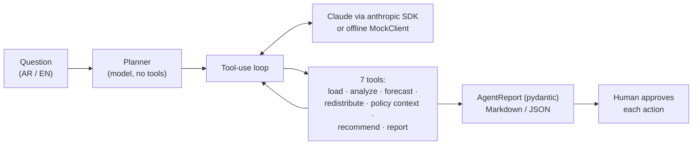

Zad (زاد) — an AI agent for reducing food waste in Hajj and Umrah catering


Zad (زاد) is Arabic for "provisions for a journey". The agent helps catering
supervisors decide how many meals to prepare for each pilgrim camp and where the
surplus should go, in Arabic or English. Every recommendation it makes is tagged with
a UN SDG target and carries a confidence note.
The problem
Meals for pilgrims are planned against registered headcounts, but attendance at each
meal varies, so operators over-prepare to be safe. The surplus is discarded or
recovered late.
Saudi Arabia measured national food loss and waste at 33.1% in its baseline
study and 27.9% at the second measurement announced in September 2025
(baseline study,
second measurement).
The national commitment is to halve food loss and waste by 2030, in line with SDG
target 12.3 (baseline study).
Hajj 1446 AH / 2025 hosted 1,673,230 pilgrims
(GASTAT).
The problem was chosen from five candidates with a scoring matrix; see
docs/PROBLEM_SELECTION.md.
Vision 2030 and SDG alignment
Agent capability	Vision 2030 objective	SDG target (indicator)	Metric produced
Demand forecast and preparation sizing	Pilgrim Experience Program — high-quality services for pilgrims	12.3 (12.3.1(b))	Meals not over-prepared; back-test error
Waste hotspot analysis	NTP Objective 19 — development and food security	12.3 (12.3.1(b))	Over-preparation rate by camp
Surplus redistribution plan	NTP Objective 19 — development and food security	2.1 (2.1.2)	Meals placed with charities
Composting of plate waste	NTP Objective 16 — reduce all types of pollution	12.5 (12.5.1)	Kilograms diverted
Unplaced-surplus alert	NTP Objective 16 — reduce all types of pollution	11.6 (11.6.1)	Meals with no taker
Primary SDG: 12.3. Full mapping, exact target and indicator wording, and the
risk and ethics analysis (PDPL, bias, Arabic-language fairness, human-in-the-loop) are
in docs/SDG_ALIGNMENT.md.
The agent's figures are operational estimates that contribute to these indicators.
They are not official indicator values.
Architecture
Planner → tool calls → reasoning → structured report. The language model plans and
chooses tools; all numbers, SDG tags and confidence notes come from deterministic
Python tools.

Details, the full diagram and the forecast method: docs/ARCHITECTURE.md.
Quickstart
Requires Python 3.11 or newer.
```bash
git clone https://github.com/zulkiflhasan/Vision2030-agent.git
cd Vision2030-agent
python -m venv .venv && source .venv/bin/activate
pip install -e ".[dev]"
```
Mock mode (no API key)
Mock mode runs the real agent loop and the real tools on the bundled synthetic data.
Only the language model is replaced by a scripted stand-in.
```bash
zad run "How many meals should we prepare tomorrow, and where should the surplus go?" --mock
zad run "كم وجبة نُعدّ غدًا وأين يذهب الفائض؟" --mock
```
Live mode (Anthropic Claude)
```bash
cp .env.example .env        # then put your key in .env; never commit it
zad run "Which camps over-prepare the most, and what should we change for 10 June?"
```
The key is read from `ANTHROPIC_API_KEY`. The model defaults to `claude-sonnet-5-5`
and can be changed with `ZAD_MODEL`.
Options
```bash
zad run "..." --lang ar                 # force the reply language (auto | en | ar)
zad run "..." --output report.md        # also save the Markdown report
zad run "..." --json report.json        # also save the structured report
zad run "..." --data-dir /path/to/data  # use your own CSV files (see data/README.md)
zad tools                               # list the tools
```
Optional web UI
```bash
pip install -e ".[ui]"
streamlit run app/streamlit_app.py
```
Tests and lint
```bash
ruff check . && ruff format --check .
pytest
```
Example run
Command:
```bash
zad run "How many meals should we prepare tomorrow, and where should the surplus go?" --mock
```
Output (unedited; a test fails if this block drifts from what the command prints):
<!-- example-output:start -->
<details open>
<summary>Report</summary>
````text
# Zad — Pilgrim Catering Food-Waste Report

**Question:** How many meals should we prepare tomorrow, and where should the surplus go?
**Mode:** mock (offline, canned language-model responses)
**Data:** Synthetic sample data generated by scripts/generate_sample_data.py (seed 2030); not real measurements.

## Executive summary

Across 14 days and 8 camps, 20.12% of prepared meals were not served. For 2025-06-10, the forecast is 52,415 meals; preparing 54,800 instead of the habitual 65,880 would avoid about 11,080 meals while keeping a 95% service level. 2,200 of 2,385 expected surplus meals can be placed with charities, subject to food-safety inspection. Details and SDG tags follow.

## Key figures

| Metric | Value |
| --- | --- |
| Period analysed | 2025-05-27 → 2025-06-09 (14 days) |
| Meal services analysed | 336 |
| Meals prepared | 923,486 |
| Meals served | 737,640 |
| Over-preparation rate | 20.12% |
| Plate waste | 44,500.4 kg (60.3 g per served meal) |
| Over-preparation hotspots | MINA-05 (26.08%), MINA-02 (24.78%), MAK-03 (22.64%) |

## Forecast and preparation plan for 2025-06-10

| Camp | Forecast meals | Recommended preparation | Habitual preparation | Meals avoided |
| --- | --- | --- | --- | --- |
| MAK-01 | 4,626 | 4,828 | 5,620 | 792 |
| MAK-02 | 5,707 | 5,934 | 6,591 | 657 |
| MAK-03 | 3,734 | 3,884 | 4,834 | 950 |
| MINA-01 | 8,317 | 8,653 | 10,197 | 1,544 |
| MINA-02 | 7,343 | 7,684 | 9,798 | 2,114 |
| MINA-03 | 9,010 | 9,456 | 11,116 | 1,660 |
| MINA-04 | 6,333 | 6,623 | 7,722 | 1,099 |
| MINA-05 | 7,345 | 7,738 | 10,002 | 2,264 |
| **Total** | **52,415** | **54,800** | **65,880** | **11,080** |

Service level: 95% · Back-test error (MAPE): 2.81% (3 days) · Confidence: high

## Surplus redistribution plan

| Camp | Charity | Meals | Distance (km) | Cold chain |
| --- | --- | --- | --- | --- |
| MINA-03 | Synthetic Food Bank A | 446 | 4 | no |
| MINA-05 | Synthetic Food Bank A | 154 | 4 | no |
| MINA-05 | Synthetic Food Bank B | 239 | 9 | yes |
| MINA-02 | Synthetic Food Bank B | 261 | 9 | yes |
| MINA-02 | Synthetic Community Kitchen C | 80 | 14 | no |
| MINA-01 | Synthetic Community Kitchen C | 320 | 14 | no |
| MINA-01 | Synthetic Food Bank D | 16 | 22 | yes |
| MINA-04 | Synthetic Food Bank D | 290 | 22 | yes |
| MAK-02 | Synthetic Food Bank D | 227 | 22 | yes |
| MAK-01 | Synthetic Food Bank D | 167 | 22 | yes |

Surplus placed: 2,200 / 2,385 (92.2%) · not placed: 185

> Every hand-over requires approval by a food-safety inspector.

## Recommendations

### R1. Size preparation to the forecast

- **Action:** Prepare 54,800 meals for 2025-06-10 instead of the habitual 65,880, following the per-camp table.
- **Expected impact:** About 11,080 meals (16.8%) not over-prepared, while covering demand at a 95% service level.
- **Vision 2030 objective:** Pilgrim Experience Program — Providing high-quality services for Hajj and Umrah pilgrims
- **SDG target:** `SDG 12.3` (indicator 12.3.1(b))
- **Confidence:** High confidence: back-test error (MAPE) of 2.81% over the last 3 days. The input is synthetic sample data, not field measurements.
- **Human approval required:** yes

### R2. Review the over-preparation hotspots

- **Action:** Review catering orders with the supervisors of: MINA-05 (26.08%), MINA-02 (24.78%), MAK-03 (22.64%), against an overall rate of 20.12%.
- **Expected impact:** Bring these camps' over-preparation rate towards the overall average.
- **Vision 2030 objective:** National Transformation Program — Objective 19: Ensure development and food security
- **SDG target:** `SDG 12.3` (indicator 12.3.1(b))
- **Confidence:** High confidence: a direct descriptive statistic over 336 records and 14 days, with no predictive model involved. The input is synthetic sample data, not field measurements.
- **Human approval required:** yes

### R3. Redistribute safe surplus to charities

- **Action:** Arrange collection of 2,200 expected surplus meals on 2025-06-10 by 4 charities as per the allocation plan, subject to food-safety inspector approval.
- **Expected impact:** 92.2% of expected surplus reaches people in need instead of being discarded.
- **Vision 2030 objective:** National Transformation Program — Objective 19: Ensure development and food security
- **SDG target:** `SDG 2.1` (indicator 2.1.2)
- **Confidence:** Medium confidence: the plan rests on forecast (not actual) surplus and on capacity declared by the charities; edibility is decided by the inspector. The input is synthetic sample data, not field measurements.
- **Human approval required:** yes

### R4. Send plate waste to composting

- **Action:** Separate plate waste (about 3,178.6 kg per day) at source and route it to composting instead of landfill.
- **Expected impact:** Up to 44,500.4 kg diverted from municipal waste over a comparable 14-day period.
- **Vision 2030 objective:** National Transformation Program — Objective 16: Reduce all types of pollution
- **SDG target:** `SDG 12.5` (indicator 12.5.1)
- **Confidence:** Medium confidence: quantities are weighed in the records, but available composting capacity is not in the data. The input is synthetic sample data, not field measurements.
- **Human approval required:** yes

### R5. Secure extra collection capacity for unplaced surplus

- **Action:** Pre-arrange additional charity capacity for about 185 meals that have no taker on 2025-06-10.
- **Expected impact:** Keeps these meals out of the municipal waste stream of the holy sites.
- **Vision 2030 objective:** National Transformation Program — Objective 16: Reduce all types of pollution
- **SDG target:** `SDG 11.6` (indicator 11.6.1)
- **Confidence:** Medium confidence: the figure is the gap between forecast surplus and declared capacity, both of which are estimates. The input is synthetic sample data, not field measurements.
- **Human approval required:** yes

## National context (published figures)

- Saudi Arabia's national food loss and waste baseline is 33.1% (food loss 14.2%, food waste 18.9%). (Source: [Alshabanat et al. (2021), Sustainability 13(16), 9444](https://doi.org/10.3390/su13169444))
- The second national measurement, announced in September 2025, put the food loss and waste index at 27.9% (food loss 12.1%, food waste 15.8%). (Source: [Argaam, citing the Saudi Press Agency (30 September 2025)](https://www.argaam.com/en/article/articledetail/id/1846487))
- 1,673,230 pilgrims performed Hajj in 1446 AH / 2025, of whom 1,506,576 came from abroad. (Source: [General Authority for Statistics (GASTAT), Hajj Statistics Publication 2025](https://www.stats.gov.sa/documents/d/guest/hajj-statistics-publication-2025en-1-pdf))
- SDG target 12.3 calls for halving per capita food waste at retail and consumer levels and reducing food losses along supply chains by 2030; progress is tracked by indicator 12.3.1. (Source: [UN Statistics Division, SDG indicator metadata 12.3.1](https://unstats.un.org/sdgs/metadata/files/Metadata-12-03-01A.pdf))

## Agent plan

1. Load and validate the meal-service data (load_service_data).
2. Measure over-preparation and plate waste by camp (analyze_waste).
3. Forecast demand and size preparation for the next service date (forecast_demand).
4. Allocate expected surplus to charities (plan_redistribution).
5. Fetch published national figures with sources (get_policy_context).
6. Build SDG-tagged recommendations with confidence notes (recommend_actions).
7. Assemble the structured report (generate_report).

## Tool calls

1. `load_service_data` — ok: 336 records, 8 camps, 14 days
2. `analyze_waste` — ok: over-preparation 20.12% overall; hotspots: MINA-05, MINA-02, MAK-03
3. `forecast_demand` — ok: 2025-06-10: forecast 52,415, prepare 54,800 (habitual 65,880); MAPE 2.81%
4. `plan_redistribution` — ok: 2,200 of 2,385 surplus meals placed (92.2%)
5. `get_policy_context` — ok: 4 sourced facts
6. `recommend_actions` — ok: 5 recommendations: R1→SDG 12.3, R2→SDG 12.3, R3→SDG 2.1, R4→SDG 12.5, R5→SDG 11.6
7. `generate_report` — ok: report built in 'en' with 5 recommendations

## Limitations

- Figures are operational estimates. They contribute to, but are not, official SDG indicator values.
- The forecast is a simple weighted average with a short history; it does not model ritual-day effects or weather.
- Food-safety clearance, special diets and the choice of beneficiaries are decided by people, not by this agent.
- Charity distances are single values per charity, not per camp.

---
The report is ready. It contains the preparation plan, the redistribution plan and the recommendations, each tagged with its SDG target and a confidence note. All actions require human approval.
````
</details>
<!-- example-output:end -->
The sample data is synthetic, so these figures demonstrate the method and say nothing
about real camps. The same question in Arabic produces the same numbers with Arabic
labels, recommendations and confidence notes.
Limitations
Synthetic data. No open camp-level dataset exists, so the agent has not been
validated on real operations. The "high" forecast confidence in the example reflects
how regular the synthetic data is.
Live mode has not been run against a real model. CI and the example above use
mock mode. The live path is tested through the real `anthropic` SDK against a local
stub of the Messages API (`tests/test_live_wire.py`), which checks the wire format,
but this repository was built without an API key, so how well Claude itself plans
and summarises here is untested.
Simple forecast. A weighted average of attendance ratios with a normal buffer.
It does not model ritual days (for example the Day of Arafah), weather or menu
effects, and three days of back-testing is a thin basis.
Redistribution is a proposal. Food-safety clearance, holding times and transport
are not modelled; an inspector decides. Charity distance is one value per charity.
Operational metrics only. The outputs are not official SDG indicator values.
Arabic. Templates are Modern Standard Arabic written by the author and not yet
reviewed by a native-speaking domain expert. The Arabic wording of Vision 2030
objectives is the author's rendering of the English programme pages.
Secondary sources. The second national measurement, and the water and labour
figures used in the problem-selection scoring, are cited from news reports of
official releases and are marked as such there.
Future work
Validate on real, permissioned meal-service data with a pilgrim service company or a
food-preservation charity.
Model ritual-day and weather effects; compare against a gradient-boosted baseline.
Per-camp charity distances, pickup time windows and food holding-time rules.
Add an emissions estimate once a verified, citable emission factor is selected.
Native-speaker review of the Arabic templates; test dialect input.
An evaluation suite for live mode (tool-selection accuracy, summary faithfulness).
Repository layout
```
src/zad/            agent.py, llm.py, models.py, cli.py, i18n.py, config.py
src/zad/tools/      data_loader, analyzer, forecaster, redistribution, recommender, policy, report, registry
src/zad/prompts/    system.md, planner.md
src/zad/reference/  national_context.json (cited national figures)
tests/              unit tests per tool, agent-loop tests, end-to-end mock tests
data/sample/        synthetic sample data (see data/README.md)
docs/               PROBLEM_SELECTION.md, SDG_ALIGNMENT.md, ARCHITECTURE.md
app/                optional Streamlit UI
scripts/            sample-data generator, README example updater
```
Author
Dr. Muhammad Zulkifl Hasan
University of Central Punjab (UCP), Lahore, Pakistan
ORCID: 0000-0002-2733-5527
Citation
```bibtex
@software{hasan_zad_2026,
  author  = {Hasan, Muhammad Zulkifl},
  title   = {Zad: An AI Agent for Reducing Food Waste in Hajj and Umrah Catering,
             Aligned with Saudi Vision 2030 and the UN SDGs},
  year    = {2026},
  version = {0.1.0},
  url     = {https://github.com/zulkiflhasan/Vision2030-agent},
  note    = {ORCID: 0000-0002-2733-5527}
}
```
A machine-readable citation is in CITATION.cff.
License
MIT — see LICENSE. The synthetic sample data is CC0-1.0.
